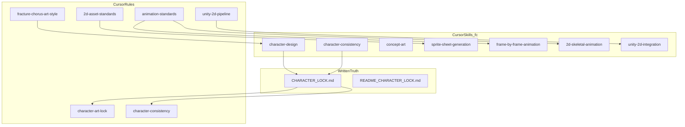

# Fractured Chorus — AI Art & Animation Capability Audit (Cursor)

**Phạm vi:** Đánh giá hệ thống **Cursor (Rules + Skills + agent)** và **stack Unity** trong repo cho pipeline nhân vật Anime 2D/JRPG từ concept → animation → import Unity.  
**Phương pháp:** Đọc nội dung thực tế các file rules/skills được liệt kê; đối chiếu `Packages/manifest.json` (không chỉnh sửa).  
**Giới hạn task:** Không sửa Rules/Skills, không gen ảnh, không đụng asset/scene/script.  
**Ngày:** 2026-11-06  

---

## 1. Nguồn đã đọc (xác minh tồn tại)

### 1.1 Rules (`.cursor/rules/`)

| File | Mục đích (tóm tắt) |
|------|---------------------|
| [`fracture-chorus-art-style.mdc`](../../.cursor/rules/fracture-chorus-art-style.mdc) | Art direction Lumina: anime/JRPG, neon có chừng mực, palette hex chủ, ưu tiên `CHARACTER_LOCK`, full body mặc định. |
| [`character-art-lock.mdc`](../../.cursor/rules/character-art-lock.mdc) | Bắt buộc đọc `CHARACTER_LOCK.md`; một lock/character; bust 1024×1536; cập nhật path; giữ `.meta` GUID. |
| [`character-consistency.mdc`](../../.cursor/rules/character-consistency.mdc) | Quy trình đọc lock + ref; bảng “consistency system”; compose với art-style + character-art-lock. |
| [`2d-asset-standards.mdc`](../../.cursor/rules/2d-asset-standards.mdc) | Naming, PNG/PSD, canvas bust/combat, sprite sheet padding; cấm ship tên IP ngoài. |
| [`animation-standards.mdc`](../../.cursor/rules/animation-standards.mdc) | Folder Animation, fps mặc định 12; frame vs skeletal; Spine chưa trong manifest; thay ref `N_Corp_*` / `Lobotomy_*` / `LCB_*`. |
| [`unity-2d-pipeline.mdc`](../../.cursor/rules/unity-2d-pipeline.mdc) | Unity 6 + URP; PSD/Aseprite import; **không** hardcode RectTransform overwrite layout scene; meta hygiene. |

### 1.2 Skills (`.cursor/skills/`)

| Thư mục / `SKILL.md` | `disable-model-invocation` |
|----------------------|----------------------------|
| [`character-design/SKILL.md`](../../.cursor/skills/character-design/SKILL.md) | `true` — brief + lock template, trích rules. |
| [`character-consistency/SKILL.md`](../../.cursor/skills/character-consistency/SKILL.md) | `true` — checklist drift + optional `_Refs/`. |
| [`concept-art/SKILL.md`](../../.cursor/skills/concept-art/SKILL.md) | `true` — mood/key art + lock nếu có nhân vật. |
| [`sprite-sheet-generation/SKILL.md`](../../.cursor/skills/sprite-sheet-generation/SKILL.md) | `true` — grid, pivot, Unity slice. |
| [`frame-by-frame-animation/SKILL.md`](../../.cursor/skills/frame-by-frame-animation/SKILL.md) | `true` — PSD/Aseprite → clip. |
| [`2d-skeletal-animation/SKILL.md`](../../.cursor/skills/2d-skeletal-animation/SKILL.md) | `true` — Unity 2D Animation vs Spine tương lai. |
| [`unity-2d-integration/SKILL.md`](../../.cursor/skills/unity-2d-integration/SKILL.md) | `true` — drop-in asset, SO wiring, không đụng layout. |

**Ghi chú:** Project còn skills khác (`background-art`, `ui-asset-generation`) — ngoài danh sách task nhưng cùng họ FC.

### 1.3 Engine / package (đọc `Packages/manifest.json`)

- **URP:** `com.unity.render-pipelines.universal` **17.4.0**
- **2D liên quan art/anim:** `2d.animation` **14.0.3**, `2d.psdimporter`, `2d.aseprite`, `2d.sprite`, `2d.spriteshape`, `2d.tilemap` (+ extras), `timeline`, `ugui`
- **Spine:** **không** có dependency trong manifest (khớp `animation-standards.mdc` / `2d-skeletal-animation` skill)

---

## 2. Trùng lặp và cách compose (tránh nhân đôi nội dung)

| Chủ đề | Rule chính | Skill / rule phụ |
|--------|------------|-------------------|
| **Identity & bust kỹ thuật** | `character-art-lock.mdc` | `character-consistency.mdc` (quy trình + storage), `fc-character-consistency` (checklist) |
| **Style thế giới** | `fracture-chorus-art-style.mdc` | `fc-concept-art`, `fc-character-design` (brief) |
| **File & export** | `2d-asset-standards.mdc` | `fc-sprite-sheet-generation`, `fc-frame-by-frame-animation` |
| **Unity** | `unity-2d-pipeline.mdc` | `fc-unity-2d-integration` |
| **Animation hành vi** | `animation-standards.mdc` | `fc-frame-by-frame-animation`, `fc-2d-skeletal-animation` |

Không cần rule mới cho “đọc lock” — đã có `character-art-lock` + `character-consistency`; skill layer là **procedure + checklist**.

---

## 3. Đánh giá 6 năng lực

### 3.1 Character Concept Generation

| Tiêu chí | Nội dung |
|----------|----------|
| **Đã có gì?** | Rule `fracture-chorus-art-style` (direction, palette, giới hạn); skill `fc-character-design` (brief, identity table, outfit, output lock draft); skill `fc-concept-art` (composition, callouts); `README_CHARACTER_LOCK.md` + per-character `CHARACTER_LOCK.md`. |
| **Cursor có thể tự động** | Soạn brief markdown; trích lock; gợi ý tên file/deliverable; routing prompt text; **không** tự “ship” ảnh cuối nếu user không gọi công cụ gen (skills đều `disable-model-invocation: true`). |
| **User phải làm** | Chốt silhouette, duyệt concept; quyết địch có dùng AI gen hay vẽ tay; cập nhật/merge `CHARACTER_LOCK.md` khi identity đổi. |
| **Công cụ** | Cursor **GenerateImage** (khi user yêu cầu); Photoshop / Krita / Aseprite; có thể skill user `ai-image-generation` / RunComfy (ngoài repo). |
| **Giới hạn** | Gen ảnh có thể **drift** khỏi lock (đã quan sát trong dự án với pose phức tạp); “concept” chưa có rule bắt buộc **turnaround** hay **expression grid** — xem `CHARACTER_ART_DIRECTION.md`. |
| **Thiếu rule/skill?** | Không có skill/rule riêng “prompt library” per character trong repo; không có “concept approval gate” (checklist sign-off) dạng một file. |

### 3.2 Character Consistency

| Tiêu chí | Nội dung |
|----------|----------|
| **Đã có gì?** | `CHARACTER_LOCK.md` per character; `character-art-lock.mdc` + `character-consistency.mdc`; skill `fc-character-consistency` (checklist face/outfit/forbidden/canvas/meta). |
| **Cursor có thể tự động** | Đọc lock; nhắc path ref; diff mô tả brief vs lock; liệt kê forbidden. |
| **User phải làm** | Duyệt visual; quyết định cập nhật lock; giữ ref chuẩn (ảnh) — optional `_Refs/` chưa bắt buộc trong rule. |
| **Công cụ** | Ảnh ref trong repo; AI gen + **human QA**. |
| **Giới hạn** | Cursor không “nhìn” pixel để chứng minh drift tự động; skill không enforce programmatic validation. |
| **Thiếu rule/skill?** | Không có automated **visual regression** hoặc **embedding** palette checker; không có schema YAML/JSON cho lock (markdown only). |

### 3.3 Layer Separation & Chuẩn bị PSD

| Tiêu chí | Nội dung |
|----------|----------|
| **Đã có gì?** | `2d-asset-standards.mdc` (PSD + PSD Importer); `unity-2d-pipeline.mdc` (PSD); `animation-standards.mdc` (PSD layers trong pipeline); repo đã chứa nhiều PSD layer animation (`Ren`, `Coda`, …). |
| **Cursor có thể tự động** | Hướng dẫn naming layer, folder structure; script **có thể** viết để validate tên layer (chưa có trong rules — ngoài scope audit). |
| **User phải làm** | Tách layer trong PS/Krita; đặt tên ổn định; export/tag frame trong Aseprite nếu dùng. |
| **Công cụ** | **Photoshop** hoặc **Krita**; Unity **PSD Importer** (`com.unity.2d.psdimporter`). |
| **Giới hạn** | Rules không mô tả **order layer** (tay trước/sau), không có template PSD; agent không mở PSD binary trong Cursor để verify. |
| **Thiếu rule/skill?** | Skill/rule “PSD layer convention” (tóc trước sau, weapon slot) chưa có file riêng; có thể là phần mở rộng của `2d-asset-standards` thay vì file mới để tránh trùng. |

### 3.4 Frame-by-Frame Animation

| Tiêu chí | Nội dung |
|----------|----------|
| **Đã có gì?** | `animation-standards.mdc` (fps 12, loop, path Animation/); skill `fc-frame-by-frame-animation` + `fc-sprite-sheet-generation`; tools package `2d.aseprite`, PSD pipeline; trong repo có `.anim` + `.controller` (pattern sẵn). |
| **Cursor có thể tự động** | Spec sheet size, pivot, naming; outline clip/state machine ở mức **mô tả** (không sửa scene trong task read-only). |
| **User phải làm** | Vẽ in-between; slice sprite trong Unity; assign clip trong Editor; thay clip ref từ `N_Corp_*` / `Lobotomy_*` / `LCB_*` (đã ghi trong audit pipeline trước). |
| **Công cụ** | **Aseprite** (thường dùng cho sheet); Unity Animator; Timeline có trong manifest nhưng không bắt buộc character. |
| **Giới hạn** | Không có rule “rig-less animation only” vs hybrid — chỉ khuyến nghị; preview timeline trong Unity không tự động từ Cursor. |
| **Thiếu rule/skill?** | Không có skill “combat animation state contract” (tên state/param Animator); có thể map vào doc gameplay thay vì rule trùng `animation-standards`. |

### 3.5 2D Skeletal Animation

| Tiêu chí | Nội dung |
|----------|----------|
| **Đã có gì?** | Package `com.unity.2d.animation`; `animation-standards.mdc` + skill `fc-2d-skeletal-animation` (Unity path + Spine tương lai). |
| **Cursor có thể tự động** | Soạn checklist rig/export; cảnh báo Spine chưa có trong manifest. |
| **User phải làm** | Rig trong Unity Skinning Editor **hoặc** Spine Editor (nếu adopt + thêm package); weight paint; test deformation. |
| **Công cụ** | Unity **2D Animation**; **Spine** (editor + runtime) — **chưa** trong `Packages/manifest.json`. |
| **Giới hạn** | Audit pipeline trước: không grep thấy `SpriteSkin` trong `.meta` — **chưa xác minh** rig đang dùng trong build; nhiều anim có thể đang sprite sequence. |
| **Thiếu rule/skill?** | Không có rule “khi nào bắt buộc skeletal vs FBF”; không có Spine import path cụ thể (đúng vì chưa có package). |

### 3.6 Unity Import & Animation Integration

| Tiêu chí | Nội dung |
|----------|----------|
| **Đã có gì?** | `unity-2d-pipeline.mdc` (import sprite, PSD, meta, URP); skill `fc-unity-2d-integration`; project Unity **6000.4.x** (từ audit trước) + URP 17.x. |
| **Cursor có thể tự động** | Nhắc PPU, Sprite Mode Multiple; không viết script overwrite RectTransform (rule project user + `unity-2d-pipeline`). |
| **User phải làm** | Mở Unity Editor: import, slice, assign `SpriteRenderer` / Animator / UI Image; wire `UnitPresetSO` fields; commit `.meta`. |
| **Công cụ** | Unity Editor; Rider/VS (IDE trong manifest). |
| **Giới hạn** | Agent không thay scene/prefab một cách an toàn mà không có bước Unity; rules **cấm** layout hack qua C# trên UI đã author. |
| **Thiếu rule/skill?** | Không có skill “animator parameter contract” hoặc “addressables” (nếu sau này cần) — chưa bắt buộc. |

---

## 4. Kiến trúc đề xuất (tận dụng hiện có, tránh trùng)

**Nguyên tắc:** mọi output hình **đi qua** lock + (style global OR chỉ lock nếu mâu thuẫn palette); file export đi qua `2d-asset-standards`; vào Unity qua `unity-2d-pipeline` + skill integration.

---

## 5. Bảng ưu tiên bổ sung (deliverable)

| Ưu tiên | Mục | Vì sao |
|---------|-----|--------|
| **P0** | Thay **sprite ref tạm** (`N_Corp_*`, `Lobotomy_*`, `LCB_*`) bằng asset FC + cập nhật clip/preset giữ GUID | Đã ghi trong `animation-standards` + audit pipeline; blocker ship/bản quyền nhận diện. |
| **P0** | **CHARACTER_LOCK** luôn có path ref + QA người trước merge | Rules/skills đã có; thiếu phần “ảnh ref” có thể là gap tổ chức folder `_Refs/`. |
| **P0** | Quy trình **meta** (commit cùng asset) | `character-art-lock` + `unity-2d-pipeline`. |
| **P1** | Chuẩn **sprite sheet** (pivot, padding) + fps/loop | `fc-sprite-sheet-generation` + `animation-standards`. |
| **P1** | Quyết định **FBF vs skeletal** cho từng nhân vật / combat scale | Skill `2d-skeletal-animation` ghi nhận Spine absent. |
| **P2** | Prompt library / optional structured lock (YAML) | Giảm drift; chưa có file — tránh trùng với markdown lock bằng cách **một** schema duy nhất nếu sau này thêm. |
| **P2** | CI script validate naming / layer list | Tự động hóa; không có trong rules hiện tại. |

---

## 6. Kết luận ngắn

- **Cursor + Rules/Skills hiện tại** cover tốt **quy trình và kỷ luật** (lock, naming, Unity import, animation convention) nhưng **không** thay được **Unity Editor**, **vẽ in-between**, hay **đảm bảo pixel-perfect consistency** mà không có người review.
- **Điểm mạnh:** `CHARACTER_LOCK` + ba lớp rule (style, lock, consistency) + skills FC tách workflow rõ.
- **Điểm yếu hệ thống:** phụ thuộc **chất lượng công cụ gen** và **QA người**; skeletal **chưa** chứng minh đang dùng trong meta; Spine **chưa** trong project.
- **Trùng lặp:** không cần rule “consistency” thứ ba — giữ `character-art-lock` (kỹ thuật + single lock) và `character-consistency` (hệ thống + optional `_Refs`).

---

*Tài liệu audit chỉ đọc repo. Chờ xác nhận trước khi thêm Rule/Skill hoặc thay đổi pipeline.*
