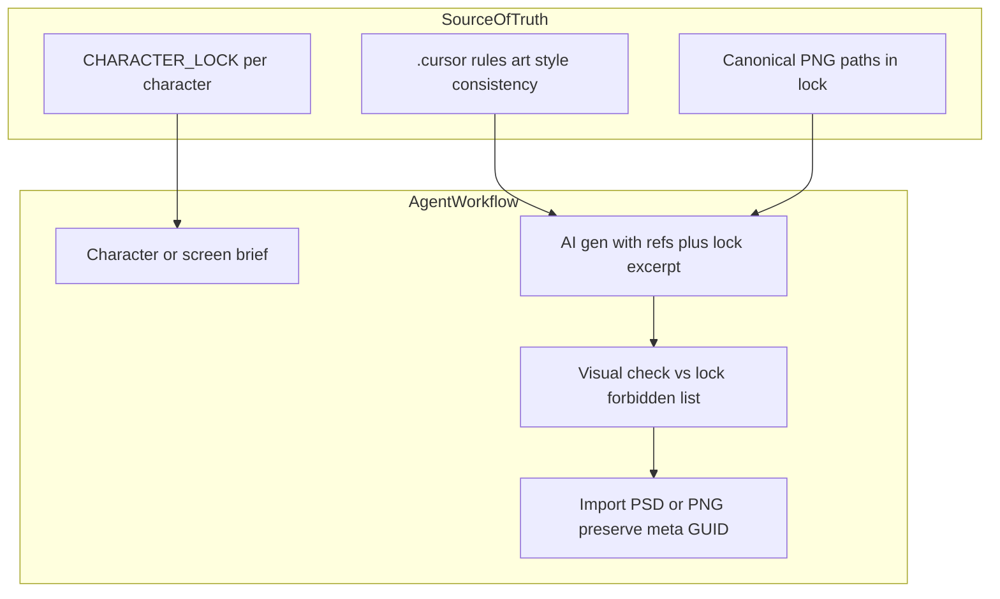

# Fractured Chorus — 2D Art & Animation Pipeline Audit

**Loại báo cáo:** chỉ đọc repo (không chỉnh sửa Unity, scene, prefab, script, asset).  
**Ngày audit:** 2026-11-06  
**Workspace:** `Fractured-Chorus1`

---

## 1. Hiện trạng project

### 1.1 Unity & render pipeline

| Hạng mục | Giá trị đã xác minh | Nguồn |
|----------|---------------------|--------|
| Unity Editor | **6000.4.0f1** (revision `8cf496087c8f`) | `ProjectSettings/ProjectVersion.txt` |
| Render pipeline | **URP** — `com.unity.render-pipelines.universal` **17.4.0** | `Packages/manifest.json` |
| Ánh xạ global settings | `UniversalRenderPipeline` trong `m_RenderPipelineGlobalSettingsMap` | `ProjectSettings/GraphicsSettings.asset` |

**Ghi chú:** `GraphicsSettings` có `m_CustomRenderPipeline: {fileID: 0}` nhưng map URP ở `m_RenderPipelineGlobalSettingsMap` — đây là cấu hình Unity 6 / URP; không suy diễn thêm ngoài file.

### 1.2 Cấu trúc thư mục Art (Fractured Chorus)

Đã xác minh các thư mục con trực tiếp dưới `Assets/FracturedChorus/Art/`:

- `Backgrounds/`
- `Characters/`
- `Narrative/`
- `Props/`
- `UI/`
- `VFX/`

### 1.3 Package 2D & liên quan (trích `Packages/manifest.json`)

| Package | Phiên bản |
|---------|-----------|
| `com.unity.2d.animation` | 14.0.3 |
| `com.unity.2d.aseprite` | 4.0.1 |
| `com.unity.2d.psdimporter` | 13.0.2 |
| `com.unity.2d.sprite` | 1.0.0 |
| `com.unity.2d.spriteshape` | 14.0.1 |
| `com.unity.2d.tilemap` | 1.0.0 |
| `com.unity.2d.tilemap.extras` | 7.0.1 |
| `com.unity.2d.tooling` | 2.0.1 |
| `com.unity.timeline` | 1.8.11 |
| `com.unity.ugui` | 2.0.0 |

**Chưa xác minh trong manifest:** **Spine** (không có dependency `com.esotericsoftware.spine` hoặc tương đương trong file đã đọc). Muốn Spine runtime cần bổ sung package/thư viện sau (ngoài phạm vi audit chỉ đọc).

### 1.4 Animation & scene (mức file)

- **Animator Controller** dưới `Assets/FracturedChorus/Art/Characters/`: **20** file `.controller` (party: `Ren`, `Coda`, `Charlotte`; thêm enemy/elite/mini/boss/KikiUeda).
- **Animation Clip** dưới cùng cây: **61** file `.anim` (glob `**/*.anim`).
- **Sprite Library / SpriteSkin:** grep `SpriteLibraryAsset` / `SpriteSkin` trong `Assets/**/*.meta` — **0 khớp**. Không kết luận “đang dùng 2D IK rig” từ meta; animation hiện có dấu hiệu **sprite sequence + Animator** (kèm nhiều PSD layer trong folder animation).

---

## 2. Danh sách & phân loại asset (đã có bằng chứng)

### 2.1 Quy ước nội bộ (canonical party + ref tạm)

| Nội dung | Bằng chứng |
|----------|------------|
| Party canon: **Coda** (Mage), **Ren** (DPS), **Charlotte** (Tank); sprite combat, animation layout | `Assets/FracturedChorus/Art/Characters/README.md` |
| Sprite ref **LoR** tên `LCB_*`, `N_Corp_*` ở root — chuyển dần sang `_Reference/`; **không** gán preset canon | Cùng file README |

### 2.2 Asset có tên/file cho thấy nguồn tham chiếu ngoại (temporary / replace)

**Chỉ phân loại khi tên file/path khớp README hoặc pattern rõ.**

| Pattern | Số file (đệ quy trong `Art/Characters`) | Ghi chú |
|---------|----------------------------------------|---------|
| `LCB_*` | **24** | Ví dụ: `Ren/LCB_Sinner_Yi_Sang_Dead_Sprite.png`, `Charlotte/LCB_Sinner_Ishmael_*.png` |
| `N_Corp*` | **172** | Chủ yếu PSD layer trong `Ren/Animation/` (Idle, Skill 1–3) + PNG `N_Corp._E.G.O_*` |
| `Lobotomy_*` | **188** | Chủ yếu PSD trong `Coda/Animation/` và một PNG `Lobotomy_E.G.O_..._Idle_Sprite.png` |

**Folder tham chiếu tách:** `Assets/FracturedChorus/Art/Characters/_Reference/LuxeConcert/` — `kiki_ref.png`, `mimi_ref.png`, `astra_ref.png` (+ `.meta`).

### 2.3 CHARACTER_LOCK & consistency

- Có **12** file `CHARACTER_LOCK.md` (mỗi nhân vật một lock): Ren, Charlotte, Coda, Mimi, Kiki, Astra, Touya, KikiUeda, MeiLin, Ryo, Haruto (+ một bản trùng path Ren trong index glob — thực tế một file).
- Template: `README_CHARACTER_LOCK.md`.
- Rule Cursor: `.cursor/rules/character-art-lock.mdc` (globs Characters + VN portraits).

### 2.4 Vấn đề `.meta` / import (để production lưu ý)

Một số PNG trong repo **không có** file `.meta` cùng tên trong workspace (ví dụ `Ren/Battle/ren_combat_*.png`). Unity thường tạo `.meta` khi import local; báo cáo **không** kết luận đầy đủ kích thước texture từ meta cho những file này — SoT **Ren** semi-chibi combat: **`ren_combat_battle_idle_semichibi_v2_full.png` — 864×1152** per `CHARACTER_LOCK.md` *(đoạn cũ 470×1109 superseded khi lead chốt v2_full).*

---

## 3. Asset cần thay thế — ưu tiên gợi ý

**Tiêu chí:** mật độ hiển thị gameplay + bằng chứng “ref tạm” trong README hoặc tên file.

| Ưu tiên | Nhóm | Lý do (có bằng chứng) |
|---------|------|-------------------------|
| **P0** | Toàn bộ clip/PSD/frame **`N_Corp_*`** gắn **Ren** combat animation | README gọi đây là sprite ref LoR; Ren lock nói battle idle custom thay `N_Corp_*` |
| **P0** | **`Lobotomy_*`** layers **Coda** (và file idle sprite cùng prefix) | Cùng họ temporary naming; trùng với convention “ref tạm” |
| **P1** | **`LCB_*`** Charlotte / Ren dead sprites, GIF idle Charlotte | Tên LCB trùng README; cần thay bằng asset Fractured Chorus |
| **P1** | Enemy **Elite 1–3**, **Enemy 1–3**, **Mini Enemy**, **KnightOfDespair** — sprite/controller đặt tên theo IP khác | Rủi ro bản quyền / nhận diện; cần roadmap thay dần (không kết luận license từng file nếu không có LICENSE) |
| **P2** | `_Reference/LuxeConcert/*_ref.png` | Ref tách — xác định mục đích (concept only vs in-game) rồi thay |
| **P2** | UI/Background/Props chưa gắn lock — audit sau theo feature | Cần inventory chi tiết theo screen (RunMap, Combat, VN) |

---

## 4. Công cụ — đã có trong project vs ngoài máy

### 4.1 Đã có trong repo (Unity Package)

- **2D Animation**: rig/skeleton workflow (package có; **chưa** thấy `SpriteSkin` trong `.meta` — có thể chưa rig hoặc asset chưa generate meta đồng bộ).
- **PSD Importer**: phù hợp layer animation hiện có.
- **Aseprite importer**: import `.ase`/`.aseprite` nếu pipeline chuyển sang Aseprite (ứng dụng Aseprite **trả phí**; importer là package Unity **miễn phí**).

### 4.2 Cursor / AI

- **GenerateImage** (Cursor native): phù hợp concept, iteration nhanh; luôn kèm `CHARACTER_LOCK.md` + ảnh ref trong repo để giảm drift.
- **GPT Image / provider khác:** skill global `ai-image-generation` / `gpt-image-2` (ngoài repo) — dùng khi cần edit/refine có kiểm soát.

### 4.3 Chỉnh sửa pixel / layer

| Công cụ | Phí | Vai trò |
|---------|-----|--------|
| **Krita** | Miễn phí | Sửa alpha, hand-cleanup, vẽ thêm |
| **Photoshop** | Trả phí | PSD native, match pipeline PSD Importer |
| **Aseprite** | Trả phí | Sprite sheet, pixel polish, tag frame |

### 4.4 Skeletal 2D

| Giải pháp | Phí | Ghi chú |
|-----------|-----|--------|
| **Unity 2D Animation** (Sprite Skin) | Package có sẵn | Chưa thấy bằng chứng đang dùng trong `.meta` |
| **Spine** | Editor trả phí + runtime license | **Không** có trong `Packages/manifest.json` |

### 4.5 Sprite sheet & frame animation

- **Aseprite**: export sheet + JSON (phổ biến).
- **PSD → Unity**: đã có nhiều layer PSD trong animation folders — tiếp tục được hoặc chuyển dần sang sheet chuẩn hóa.

---

## 5. Kiến trúc đề xuất — AI Art & Animation Assistant (Cursor)

**Nguyên tắc:** mọi lượt gen **đọc lock trước**; **không** tạo lock thứ hai; sau khi có file final **cập nhật đường dẫn trong lock** (theo `character-art-lock.mdc`).

---

## 6. Quy trình sản xuất đề xuất (tóm tắt)

| Luồng | Bước chính | AI | Thủ công | Ghi chú Unity |
|-------|------------|-----|----------|----------------|
| Character Design | Brief → silhoutte → ref sheet | Concept, iteration | Chốt silhoutte, palette | Không |
| Character Portrait / Bust | Lock → 1024×1536 PNG | Gen + revise | Alpha cleanup | UI: PreserveAspect; **không** hardcode RectTransform runtime |
| Background | Moodboard → paint | Gen matte | Grade, seam fix | Sprite hoặc full-screen raw image |
| UI / Icon | Wireframe → style pass | Icon gen | Pixel-align 2x scale | uGUI / Toolkit theo scene hiện có |
| Frame-by-frame | Storyboard → sheet | Key frames | Inbetween, Aseprite/PS | Animator + clips |
| Skeletal | Model sheet → rig | Không | Rig weights (Spine hoặc 2D Animation) | Package Spine hoặc SpriteSkin |
| Unity Integration | Import → preset → wire | Script stub only if needed | Assign sprite, animator | Giữ GUID `.meta` khi replace |

---

## 7. Character Consistency System — trạng thái & mở rộng

**Hiện có:**

- File **`CHARACTER_LOCK.md`** / nhân vật: identity, face/hair, outfit hex, canvas bust, expression table, **paths** asset canon.
- Rule **`.cursor/rules/character-art-lock.mdc`**.

**Đề xuất bổ sung (không bắt buộc trong audit):**

| Thành phần | Mục đích |
|------------|----------|
| `Art/Characters/<Name>/_Refs/` hoặc `_Consistency/` | Ảnh chuẩn front/side/expression; chỉ path trong lock trỏ tới đây |
| Palette & costume table | Giữ trong lock (đã có một phần); thêm bảng “FORBIDDEN” ngắn (màu mắt, phụ kiện) |
| Prompt templates | `Documentation/Art_Pipeline/prompts/<CharacterId>_*.md` — copy đoạn lock + style Fractured Chorus |
| Validation (optional) | Checklist skill `character-consistency` trước khi merge art |

Chi tiết kỹ thuật và bảng từng nhân vật: xem **`CHARACTER_ART_AUDIT.md`**.

---

## 8. Lộ trình triển khai theo giai đoạn

| Giai đoạn | Việc | Exit criteria |
|-----------|------|----------------|
| **0** | Audit (báo cáo này) — frozen | Hai file MD trong `Documentation/Art_Pipeline/` |
| **1** | Thay **P0**: Ren animation `N_Corp_*`, Coda `Lobotomy_*` → clip/sheet nội bộ | Không còn PSD placeholder trong preset canon đang ship |
| **2** | Thay **P1** `LCB_*` party; đồng bộ `CHARACTER_LOCK` paths | Controller trỏ clip mới; retain `.meta` |
| **3** | Enemy pool: redesign silhouette + tên file neutral | Không còn tên IP third-party trên file trong build |
| **4** | Quyết định skeletal: **2D Animation** vs **Spine** + chuẩn export | Một nhân vật pilot rig đầy đủ |
| **5** | Cursor rules + project skills (`/.cursor/skills/*`) — đã thêm trong phase implement | Agent luôn load lock + style rule |

---

## 9. Rủi ro & việc chưa xác minh

- **Nguồn gốc pháp lý** từng file: chỉ đánh dấu “temporary ref” khi README hoặc tên file khớp; không có LICENSE trong audit này → **không** kết luận license.
- **Scene/prefab wiring đầy đủ:** liệt kê object đang reference sprite nào cần mở Unity hoặc grep GUID trong `.unity` — **chưa** làm exhaustive trong audit chỉ đọc ngắn.
- **`docs/ASSET_INVENTORY.md`** được README Characters nhắc tới — **file không tồn tại** trong workspace đã quét → ghi **thiếu / chưa xác minh**.

---

**Kết thúc báo cáo pipeline.** Chờ xác nhận trước khi chỉnh asset hoặc cài thêm package.
